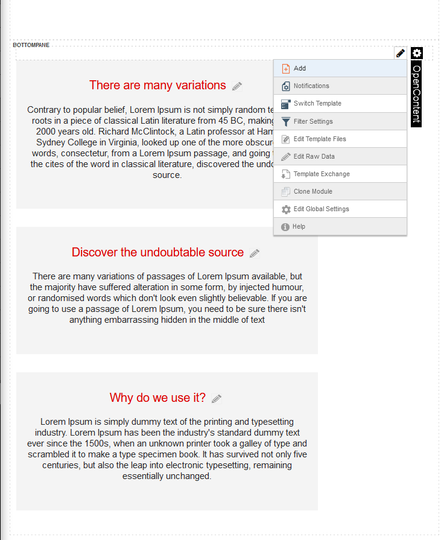

# Embedded Form with an Additional Data dropdown

This template builds on **11.01 Embedded Form**. The detail page has a front-end form ("Ask for a Quote"), and one of its fields is a dropdown. The dropdown's options are not hard-coded: they come from the module's **Additional Data** ("Products"), so an editor can change the list without touching the template.



## How it works

1. `detail.hbs` registers the form scripts with `{{registereditform "form"}}` and renders an empty `<div class="contactform">`.
2. `template.js` calls `$('.contactform').openContentForm(...)`. This fetches `form-schema.json` and `form-options.json` from the server and renders them with Alpaca.
3. The `Product` field in `form-options.json` is a `select2` field with a `dataService`. When it renders, it posts to `OpenContentAPI/LookupData` with the `dataKey`, `valueField` and `textField`.
4. `LookupData` looks up the Additional Data entry named by `dataKey` in `manifest.json`, reads the stored items, and returns them as `{ value, text }` pairs. The dropdown shows those pairs.
5. On submit, the chosen `value` is sent with the rest of the form and shows up in the submission and notification email.

`LookupData` only needs **View** permission, so the dropdown also works for anonymous visitors.

### Why `registereditform` and not `registerform`

`{{registerform}}` loads only basic Alpaca, which doesn't include `select2` or the `dataService` lookup. The field then fails to render.

`{{registereditform "form"}}` loads the OpenContent field bundle. The `"form"` argument makes it read `form-options.json`, so it adds select2.js and select2.css because the form uses a `select2` field. Without the argument it reads `options.json`, which has no `select2` field, and select2 is not loaded.

This bundle is heavier than `registerform`, so only use it when the form needs one of these fields.

## Files involved

| File | Role |
|---|---|
| `manifest.json` | Declares the Additional Data entry under `additionalData` |
| `products-schema.json` / `products-options.json` | Structure and edit form of the Additional Data (a list of products) |
| `form-schema.json` | Adds the `Product` field to the front-end form |
| `form-options.json` | Makes `Product` a `select2` field that reads from Additional Data |
| `detail.hbs` | Loads the scripts with `{{registereditform "form"}}` and holds the form container |
| `template.js` | Starts the form and handles submitting |

## Hooking it up in your own template

### 1. Declare the Additional Data in `manifest.json`

```json
"additionalData": {
    "products": {
        "title": "Products",
        "scope": "module"
    }
},
```

- The key (`products`) is what `dataKey` refers to. It also sets the file names in step 2.
- `scope` sets where the data is stored and shared: `module`, `tabmodule`, `tab` or `portal`. Use `portal` to share one list across modules that use the same template.
- Don't use `form` as the key, because `form-schema.json` and `form-options.json` already belong to the front-end form.

### 2. Describe the data: `<key>-schema.json` and `<key>-options.json`

The root of the schema must be an **array**, because `LookupData` expects a list of items:

```json
{
  "type": "array",
  "items": {
    "type": "object",
    "properties": {
      "Title": { "type": "string", "title": "Title" }
    }
  }
}
```

You can add more properties, such as an `Id` or a `Price`. You pick which ones to use for the dropdown in step 4.

### 3. Add the field to `form-schema.json`

```json
"Product": {
  "type": "string",
  "title": "Product"
}
```

### 4. Configure the dropdown in `form-options.json`

```json
"Product": {
  "type": "select2",
  "dataService": {
    "action": "LookupData",
    "data": {
      "dataKey": "products",
      "valueField": "Title",
      "textField": "Title"
    }
  }
}
```

- `dataKey` is the key from `manifest.json`.
- `valueField` is the property that gets submitted.
- `textField` is the property the visitor sees in the list.

This template uses `Title` for both, so the submission and email contain the readable product name. If you use an `Id` as `valueField`, the email only shows that id.

Optional `data` settings:
- `dataMember`: use this when the list is a property of the Additional Data rather than its root.
- `childrenField`: shows nested items, indented with `..`.

### 5. Register the scripts in your view

Replace `{{registerform}}` with:

```handlebars
{{registereditform "form"}}
```

You don't need to change `template.js`. `openContentForm` already passes the services framework to the form fields, so the lookup call sends the module headers and the anti-forgery token.

### 6. Fill the data

In DNN, open the module's edit menu and choose **Products** (the `title` from the manifest). Add a few items and save.

## Testing

1. Open an item's detail page while logged out.
2. The Product dropdown should list the items you entered.
3. In the browser's network tab, `POST .../API/OpenContent/OpenContentAPI/LookupData` should return 200 with a list of `{ value, text }` pairs.
4. Submit the form and check that the chosen product is in the submission and the notification email.

## Troubleshooting

- **The dropdown shows up as a plain text box, or there's a console error about select2**: the view still uses `{{registerform}}`, or `{{registereditform}}` is missing the `"form"` argument.
- **`LookupData` returns 500 saying the manifest "does not contain a AdditionalData definition with key [...]"**: `dataKey` doesn't match a key under `additionalData` in `manifest.json`.
- **The dropdown is empty but the call returns 200**: no data has been entered yet, the schema root isn't an array (see `dataMember`), or `valueField`/`textField` don't match the property names.
